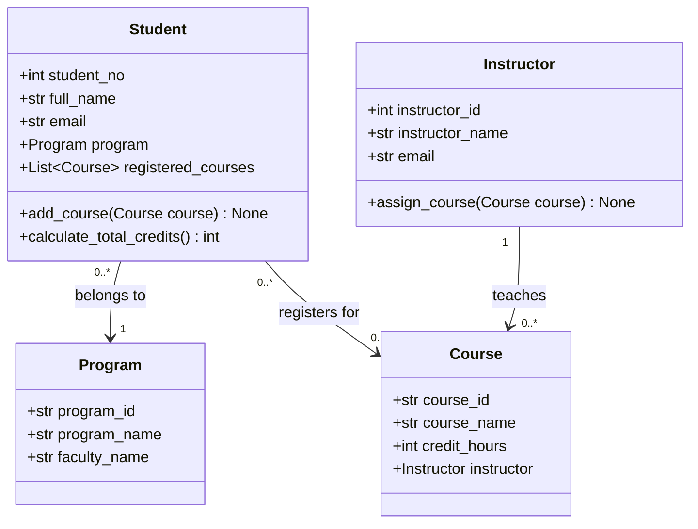

# Student Class Diagram

In this assignment, I designed a simple Student Management System using a UML Class Diagram and Python.

The system has four main classes: Student, Program, Course, and Instructor. Each class has different information and functions. They are connected to each other to represent a basic university system.

## UML Class Diagram


### Class Descriptions

**Student**

The Student class stores basic information about students and the courses they take.

- `student_no`: Student ID number.
- `full_name`: Student's full name.
- `email`: Student's email address.
- `program`: The program the student belongs to.
- `registered_courses`: Courses registered by the student.
- `add_course()`: Adds a course to the student's course list.
- `calculate_total_credits()`: Calculates the total credits of registered courses.

**Program**

The Program class stores information about university programs.

- `program_id`: Program ID.
- `program_name`: Name of the program.
- `faculty_name`: Name of the faculty.

**Course**

The Course class contains information about the courses offered by the university.

- `course_id`: Course ID.
- `course_name`: Name of the course.
- `credit_hours`: Number of credits.
- `instructor`: Instructor assigned to the course.

**Instructor**

The Instructor class stores information about instructors.

- `instructor_id`: Instructor ID.
- `instructor_name`: Instructor's name.
- `email`: Instructor's email address.
- `assign_course()`: Assigns the instructor to a course.

## Mapping UML Design to Python

| UML Component | Python Equivalent |
|---|---|
| Class | `class` |
| Attribute | Instance variable |
| Constructor | `__init__()` |
| String | `str` |
| Integer | `int` |
| List | `list` |
| Method | `def` |
| Object | Class instance |
| Relationship | Object reference |


## 5. Expected Output

```text
John Smith assigned to Programming
John Smith assigned to Database Systems
John Smith assigned to Software Engineering

Programming added successfully.
Database Systems added successfully.
Software Engineering added successfully.

--- Student Information ---
Student No: 202501
Full Name: John Smith
Email: john@example.com
Program: Software Engineering

--- Registered Courses ---
Course: Programming
Credits: 4
Instructor: John Smith
--------------------
Course: Database Systems
Credits: 3
Instructor: John Smith
--------------------
Course: Software Engineering
Credits: 3
Instructor: John Smith
--------------------

Total Credits: 10
```
